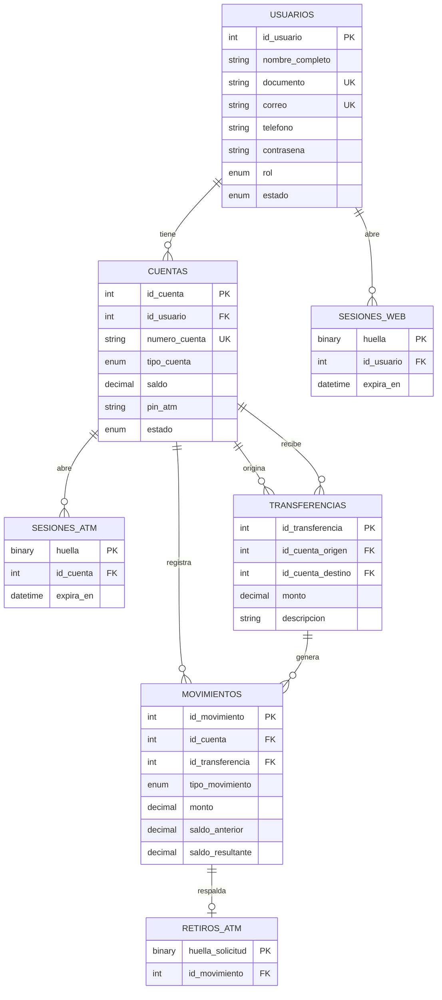

# Diagrama entidad-relación

Esquema final de la base de datos del Simulador Bancario Web, incluyendo las tablas base y las agregadas por las migraciones (sesiones web, sesiones ATM y retiros ATM).

